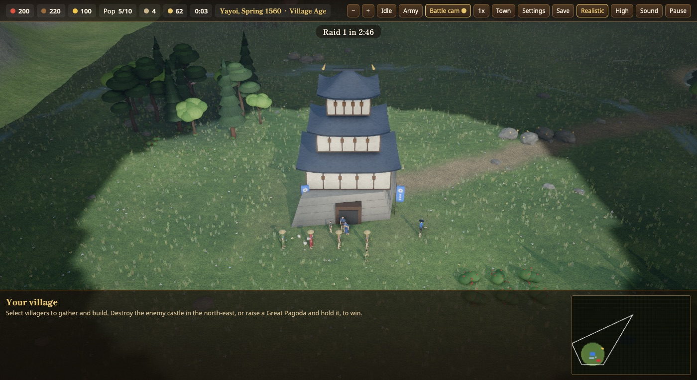
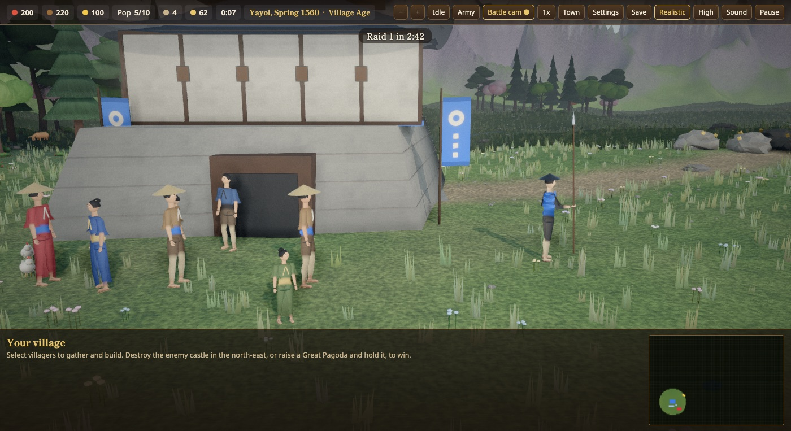
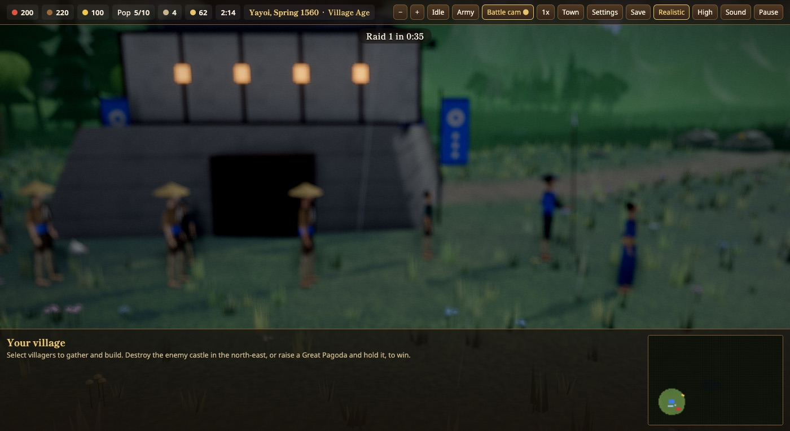
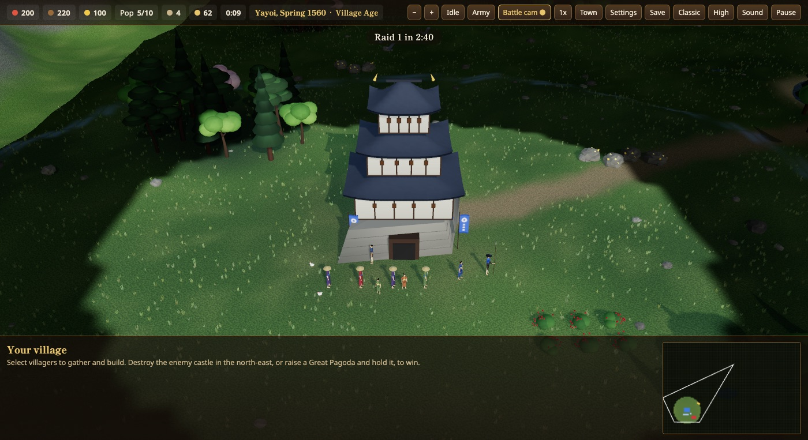

<div align="center">

# ⛩️ Age of Shoguns

**A real-time strategy game set in feudal Japan, 1560. It runs in the browser.**

Build a village in Kai Province, raise an army of samurai and ashigaru, and survive the ronin raids.<br>
Then destroy the enemy castle, or raise a Great Pagoda and hold it to win.




</div>

---

## Contents

- [Play it](#-play-it)
- [Screenshots](#-screenshots)
- [Features](#-features)
- [Two graphics modes](#-two-graphics-modes-classic-and-realistic)
- [How to win](#-how-to-win)
- [Controls](#-controls)
- [Units and buildings](#-units-and-buildings)
- [How it's built](#-how-its-built)
- [Project layout](#-project-layout)
- [Credits](#-credits)

## 🎮 Play it

**With Docker (recommended):**

```sh
git clone git@github.com:Subhagatoadak/Age-Of-Shoguns.git
cd Age-Of-Shoguns
docker compose up -d --build
```

| What | URL |
| --- | --- |
| 3D game | <http://localhost:8686> |
| Classic 2D game | <http://localhost:8687> |
| 3D game with hot reload (`docker compose --profile dev up`) | <http://localhost:5173> |

To use other ports, set `SHOGUNS_3D_PORT`, `SHOGUNS_2D_PORT` or `SHOGUNS_DEV_PORT`. Stop everything with `docker compose down`.

**Without Docker (Node 20+):**

```sh
cd 3d
npm install
npm run dev      # http://localhost:5173
npm run build    # static site in 3d/dist/
```

## 📸 Screenshots

| Realistic mode, at ground level | Night and rain, with depth of field in the battle cam |
| --- | --- |
|  |  |

| Classic mode | Realistic mode |
| --- | --- |
|  |  |

## ✨ Features

**A strategy game**
- Gather food, wood and gold, then build houses, rice paddies, storehouses, barracks, watchtowers, a blacksmith, a temple, a stable, a market and cattle ranches.
- **Four ages:** Village → Feudal → Castle → Shogunate. Each one unlocks buildings, units and upgrades and raises the population cap.
- **Upgrades:** iron tools, tamahagane steel, lamellar armour, fletching, masonry and Zen discipline.
- **National borders.** Your territory spreads out from your buildings and glows on the ground. You can only build inside it, and your soldiers lose health over time while they are in enemy land.
- **Ronin raids** come in waves, and every fifth wave is led by a warlord. In Settings you can choose when raids start, how often they come and how big they are, or turn them off.
- **Battle formations:** cavalry and melee units march in front, archers behind them and monks at the rear.
- Three difficulty levels. The game autosaves every minute and you can pick it up again with **Continue**.

**A living town**
- Families move into your houses. Men, women and children go to market, pray at the temple, farm, chat and play during the day and sleep at night.
- Children are born and grow up and elders pass away. When the town is happy newcomers arrive; when it isn't, families leave.
- Click anyone in town to see who they are. The **Town** panel shows happiness, taxes, food and a chronicle of what has happened. You can also hold *matsuri* festivals at the temple.
- Cattle graze on the ranches, chickens peck around the houses, and deer roam the forests and run from soldiers.

**A world that changes**
- The calendar runs month by month from 1560, using the old Japanese month names. Cherry blossom comes in spring, the land is green in summer, maples turn red in autumn and snow falls in winter.
- Day turns to night. The sky is physically based, the moon lights the valley at night, and stars come out.
- Rain and snow change the light, the fog and how wet the ground looks.

**Cinematic**
- The game opens on the globe and flies down to Kai Province.
- **Battle cam (T).** During raids the camera films duels up close. It adds letterbox bars, slows down on killing blows and shakes on hits.
- Every character is a skinned, animated body, and fights use martial-arts moves.

## 🖼️ Two graphics modes: Classic and Realistic

The **Realistic / Classic** button in the top bar (or the **R** key) switches between the two modes while you play, and your choice is saved. Classic draws exactly what the game drew before Realistic mode existed, so it stays the fast option.

| Feature | Classic | Realistic |
| --- | :---: | :---: |
| Tone mapping | ACES | AgX, with a colour grade, vignette and film grain |
| Ambient occlusion (GTAO) | – | ✅ |
| Height fog that glows toward the sun | – | ✅ |
| Lake | Flat | Real reflections |
| Ground detail | – | Procedural detail, triplanar mapping and bump |
| Grass, ferns, flowers, pebbles and fallen leaves | Some | Dense |
| Shadows | 2048 (1024 on Low) | 4096, fitted to the camera and snapped to texels |
| Depth of field in the battle cam | – | ✅ |
| Foot placement on slopes (IK), leaning, breathing, looking at targets | – | ✅ |
| Footprints, dust from feet, knockback on hits | – | ✅ |

Realistic mode is on by default on desktop and off on screens 700 px wide or narrower. The **High / Low** quality button is a separate setting and works in both modes.

## 🏯 How to win

- **Conquest:** destroy the enemy castle in the north-east.
- **Wonder:** build the **Great Pagoda** and hold it for **3 minutes** while the enemy attacks it with everything they have.

You lose if your castle falls.

## 🕹️ Controls

| Action | Mouse / keyboard | Touch |
| --- | --- | --- |
| Move the camera | Left-drag, two-finger scroll, or WASD / arrow keys | One-finger drag |
| Zoom | Mouse wheel, pinch, or the − / + buttons | Pinch |
| Rotate | Q / E or middle-drag | Twist |
| Select | Click, or Shift+drag to box-select | Tap |
| Command (move, attack, gather, build) | Right-click | Tap |

| Key | Does |
| --- | --- |
| **Z X C V …** | Actions in the selection panel |
| **Ctrl+1–9** / **1–9** | Save / select a group (press twice to jump to it) |
| **Space** | Jump to the last alert |
| **H** | Go to your castle |
| **.** | Select an idle villager |
| **G** | Select your army |
| **T** | Battle cam |
| **R** | Switch between Realistic and Classic |
| **F** | Change game speed |
| **P** | Pause |
| **Esc** | Skip the intro / cancel placing a building |

## ⚔️ Units and buildings

| Unit | Trained at | Role |
| --- | --- | --- |
| Villager | Castle | Gathers, builds and repairs |
| Ashigaru spearman | Barracks | Cheap front-line infantry |
| Archer | Barracks | Long range |
| Samurai | Barracks (needs a blacksmith) | Elite melee |
| Sohei monk | Temple | Heals nearby units |
| Mounted samurai | Stable | Fast, heavy cavalry |

Other buildings: **House** (population), **Rice paddy** and **Cattle ranch** (food), **Storehouse** (drop-off point and iron tools), **Watchtower** (defence, holds a garrison), **Blacksmith** (steel, armour and fletching), **Market** (trade), and **Great Pagoda** (the wonder).

## 🛠️ How it's built

- **Three.js r170 + Vite.** There are no 3D model files and no texture images. All buildings, trees, people, horses and armour are generated by code when the game starts, and each model is merged into a single draw call.
- **Simulation and rendering are separate.** `3d/src/game/` holds the rules (economy, AI, A* pathfinding, combat, raids, the town's society) and doesn't touch Three.js. The view layer keeps a 3D object in step with each entity in the simulation.
- **Shader hooks:** fog of war, national borders, wind in grass and trees, autumn colours and snow cover are added to Three.js's standard materials with `onBeforeCompile`.
- **Realistic mode** is a self-contained layer (`3d/src/gfx/realism.js`). It adds a post-processing chain (GTAO → height fog → depth of field → bloom → SMAA → colour grade) and an animation layer that runs after the animation mixer. Each Realistic-only shader branch is switched by a uniform, so Classic renders exactly as before.
- **Docker:** a multi-stage build that serves the production 3D game from nginx, plus a dev profile with hot reload.

## 📁 Project layout

```
Age-Of-Shoguns/
├── 3d/                      # the 3D game (Three.js + Vite)
│   ├── src/game/            # simulation: rules, AI, pathfinding, society
│   ├── src/gfx/             # terrain, sky, models, bodies, rigs, realism
│   ├── src/ui/hud.js        # HUD and minimap
│   ├── src/director.js      # cinematic battle camera
│   └── Dockerfile           # production (nginx) and dev targets
├── index.html               # the original 2D game (Phaser), in one file
├── docker-compose.yml
└── docs/screenshots/
```

[3d/README.md](3d/README.md) has a file-by-file map of the 3D code.

## 🙏 Credits

- Coastlines on the opening globe: [Natural Earth](https://www.naturalearthdata.com/) (public domain).
- Built with [Three.js](https://threejs.org/), [Vite](https://vitejs.dev/) and [Phaser](https://phaser.io/) (2D version).
